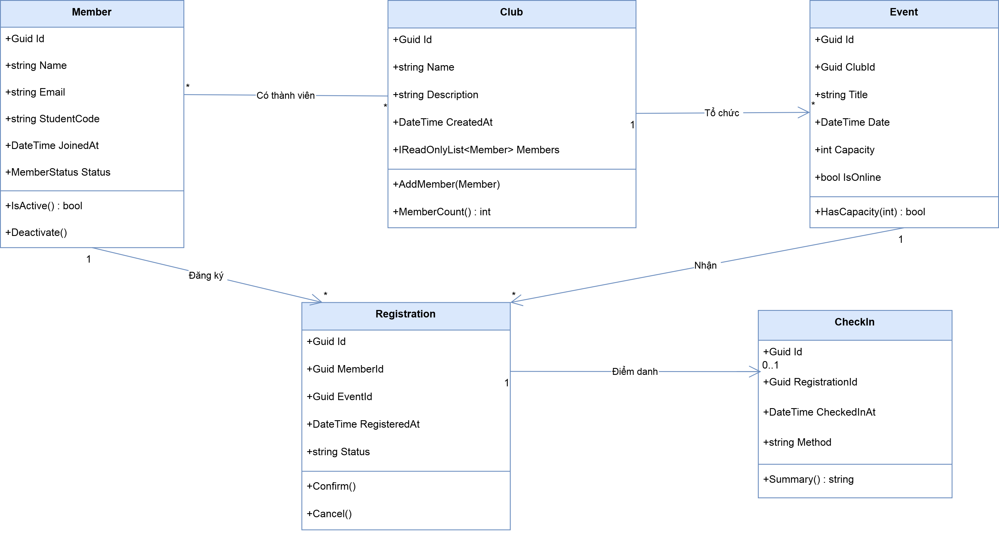

# Hi there, I'm Lê Hồng Gấm 👋

### 🎯 Aspiring Software Tester / QA Engineer | Software Engineering Student

Chào mừng bạn đến với GitHub của mình! Mình là sinh viên chuyên ngành Kỹ thuật Phần mềm tại Đại học Đồng Tháp. Định hướng trọng tâm của mình là **Đảm bảo chất lượng phần mềm (Quality Assurance & Software Testing)**.

Với nền tảng trực tiếp tham gia lập trình và xây dựng các hệ thống từ Backend đến Frontend, mình có lợi thế lớn trong việc đọc hiểu source code, nắm bắt kiến trúc hệ thống, phát hiện sớm các lỗi tiềm ẩn (code-level bugs) và xây dựng các kịch bản kiểm thử (Manual & Automation) bám sát logic nghiệp vụ.

---

## 👩‍💻 Về bản thân

- 🎓 **Học vấn:** Sinh viên chuyên ngành Kỹ thuật Phần mềm — Đạt học bổng Khuyến khích học tập.
- 🎯 **Mục tiêu nghề nghiệp:** Manual QA / Automation Tester Intern & Fresher.
- 🔍 **Đang trau dồi:** Test Automation frameworks, Performance/API Testing (Postman), quy trình CI/CD tích hợp kiểm thử, và Tiếng Anh chuyên ngành.
- 💬 **Hỏi mình về:** Lập Test Plan, thiết kế Test Cases, Automation Testing với Python (Pytest), kiểm thử hộp trắng (White-box Testing), SQL cho kiểm thử cơ sở dữ liệu, C# .NET, Java, và kiến trúc hệ thống (MVC, 3-Tier).
- ⚡ **Phương châm làm việc:** Chất lượng không phải là một hành động kiểm tra ở bước cuối, mà là một quy trình cần được xây dựng xuyên suốt vòng đời sản phẩm.

---

## 🛠️ Kỹ năng & Công cụ

**Kiểm thử phần mềm (Testing Core):**
> Test Planning, Test Case Design, Functional & Non-Functional Testing, Black-box & White-box Testing, Branch/Decision Coverage, Regression Testing, Bug Reporting & Tracking.

**Test Automation & Scripting:**
> Python, Pytest, unittest, pytest-mock, pytest-cov (Coverage report), Automated Scripts (Data validation, GUI automation).

**Lập trình & Phát triển ứng dụng (Development):**
> Python (PyQt6/PySide6, GUI Apps), C#, Java, C++, HTML/CSS, JavaScript, PHP, Windows Forms. Nắm vững kiến trúc MVC, Mô hình 3 lớp (3-Tier), OOP.

**Cơ sở dữ liệu & Data Validation:**
> SQL Server, MySQL, SQLite, Entity Framework, JDBC. Viết truy vấn SQL phức tạp phục vụ cả phát triển tính năng lẫn kiểm tra tính toàn vẹn dữ liệu (Data Integrity).

**Quản lý & Hợp tác:**
> Git/GitHub, Agile/Scrum, LaTeX (Báo cáo kỹ thuật), Draw.io (UML/Use Case), Figma (UI/UX).

---

## 🚀 Dự án tiêu biểu

### 1. MiniShop - Software Testing & Test Automation Project
- **Vai trò:** QA / Tester (Chuyên trách kiểm thử)
- **Công việc thực hiện:**
  - Soạn thảo **Test Plan**, thiết kế bộ **Test Cases** chi tiết bao gồm kịch bản luồng chính (Happy Path), luồng phụ và ca kiểm thử biên (Boundary Value Analysis / Equivalence Partitioning).
  - Phát triển kịch bản kiểm thử tự động (**Automation Test Scripts**) bằng Python (`pytest`, `unittest`, `pytest-mock`).
  - Phân tích và đo lường độ phủ mã nguồn (Branch Coverage, Statement Coverage) và lập báo cáo kết quả kiểm thử.

### 2. SuperMarket - Ứng dụng Quản lý Bán hàng Siêu thị
- **Vai trò:** Developer (Lập trình chức năng)
- **Công nghệ:** Python, Desktop GUI (PyQt6 / Tkinter), Database (MySQL / SQLite), OOP.
- **Công việc thực hiện:**
  - Lập trình toàn bộ ứng dụng bằng Python: Xây dựng giao diện Desktop, xử lý logic quản lý danh mục hàng hóa, quản lý kho, lập và xuất hóa đơn bán lẻ.
  - Tối ưu hóa xử lý sự kiện giao diện (UI Event Handling), bắt lỗi và validate dữ liệu đầu vào trực tiếp bằng Python nhằm tránh crash ứng dụng khi nhập sai kiểu dữ liệu.
  - Tự viết các hàm kiểm thử đơn vị (Unit Test) cho logic tính toán tổng tiền, chiết khấu và kiểm tra số lượng hàng tồn trước khi thanh toán.

### 3. QL_CuaHangBanThuocTruSau (Hệ thống Quản lý Bán Thuốc trừ sâu)
- **Vai trò:** Developer (Lập trình chính)
- **Công nghệ:** C# .NET, Windows Forms, SQL Server, Entity Framework, Kiến trúc 3 lớp (3-Tier).
- **Công việc thực hiện:**
  - Lập trình các module nghiệp vụ: Quản lý danh mục sản phẩm, tính hạn sử dụng thuốc, xuất - nhập kho và tính toán hóa đơn bán lẻ.
  - Thiết kế cơ sở dữ liệu quan hệ, viết Stored Procedures, Queries và ánh xạ dữ liệu qua ORM Entity Framework.
  - Tự kiểm thử đơn vị cho tầng Business Logic và xử lý triệt để các trường hợp ngoại lệ nhập liệu (Exception Handling).

### 4. Hệ thống Quản lý Bán hàng Điện tử (Phong Vũ)
- **Vai trò:** Project Lead / Developer & Requirements Analyst
- **Công nghệ:** Desktop Application, SQL Server, Cấu trúc dữ liệu & Thuật toán.
- **Công việc thực hiện:**
  - Lập tài liệu đặc tả yêu cầu phần mềm (**SRS**), thiết kế mô hình Use Case, ERD và Wireframe.
  - Tham gia code các module chức năng bán hàng và quản trị dữ liệu.
  - Thực hiện kiểm thử tích hợp (Integration Testing) và kiểm tra chấp nhận người dùng (UAT) trước khi hoàn tất dự án.

### 5. Kinetic GOATs Hotel - Web Quản lý Khách sạn
- **Vai trò:** Developer (Backend & Database)
- **Công nghệ:** Java, MVC Architecture, Servlet/JSP, SQL Server.
- **Công việc thực hiện:**
  - Xây dựng hệ thống đặt phòng, quản lý trạng thái phòng và phân quyền người dùng theo chuẩn mô hình MVC.
  - Thiết kế và tối ưu các bảng dữ liệu, ràng buộc khóa ngoại để đảm bảo tính nhất quán dữ liệu khi phát sinh giao dịch đồng thời.

### 6. AgroFlow - Hệ thống IoT Quản lý Tưới tự động
- **Vai trò:** Team Member (Phân tích hệ thống & Phát triển đề xuất)
- **Công nghệ:** C# .NET Backend, IoT (ESP32, Cảm biến), Mobile UI.
- **Công việc thực hiện:**
  - Tham gia thiết kế luồng xử lý dữ liệu giữa thiết bị cảm biến và máy chủ trung tâm.
  - Xây dựng đề xuất giải pháp kỹ thuật, phân tích tính khả thi và thẩm định chất lượng hoạt động của hệ thống.

---

## 📫 Liên hệ

- **Email:** lehonggam124@gmail.com
- **LinkedIn:** [linkedin.com/in/lehgam](https://www.linkedin.com/in/lehgam/)
- **GitHub:** [https://github.com/lehg26th/](https://github.com/lehg26th/)
---

## 🎯 Bài tập Chương 1: Sơ đồ lớp EduHub
Dưới đây là kết quả mô hình Domain bài toán EduHub:

Cảm ơn bạn đã ghé thăm trang cá nhân của mình!
